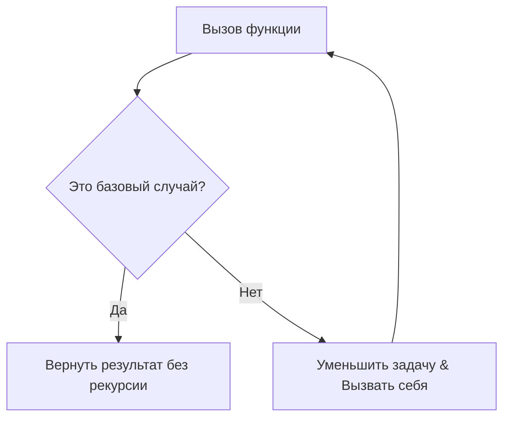

# Рекурсия
Это метод программирования, используемый во многих алгоритмах. Рекурсией называется вызов функции самой себя. 
Если говорить просто: вы решаете большую задачу, разбивая её на точно такую же, но меньшую подзадачу, и повторяете это, пока не дойдёте до самого простого случая (который можно решить сразу). 
### Пример решение задачи рекурсивным методом
Представьте, что ваша цель - найти ключ в коробке. Вы открываете коробку и есть два исхода событий:  либо там ключ (**базовый случай**), либо там другая коробка (в этом случае надо заново вызвать функцию открытия коробки  - т.е **Рекурсивный вызов**)

Любая правильная рекурсивная функция обязана состоять из двух ключевых компонентов. Если пропустить хотя бы один, программа либо завершится ошибкой, либо зависнет навечно.

